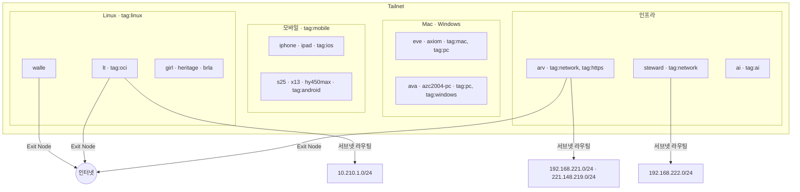

# Tailscale 네트워크 다이어그램

2026-11-22 기준. 장비 전체 목록은 [Tailnet 디바이스 스냅샷](./devices.json)에서 확인할 수 있습니다.

## 네트워크 구성

## 접근 정책

| 기능 | 적용 범위 |
|---|---|
| Tailnet 통신 | 현재 ACL은 Tailnet 내부 통신을 허용합니다. 실제 연결은 직접 연결 또는 릴레이를 사용할 수 있습니다. |
| Tailscale SSH | 태그 장비끼리 비루트 계정을 허용합니다. 허용된 사용자 그룹은 태그 장비와 자기 소유 장비에 접속할 수 있습니다. 목적지에서 Tailscale SSH를 활성화해야 합니다. |
| Exit Node | `arv`, `lt`, `walle`이 Exit Node로 표시됩니다. |
| Funnel | `tag:https`에 Funnel 사용 권한을 부여합니다. 실제 공개 서비스는 장비 설정에 따릅니다. |
| Taildrop 수신 정책 | `tag:linux`, `tag:pc`, `tag:mobile`, `tag:oci`를 대상으로 합니다. |

전체 규칙은 [ACL 정책 문서](./acl.md)에서 확인할 수 있습니다.
